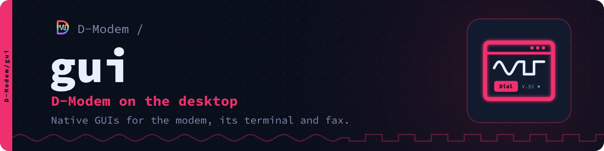
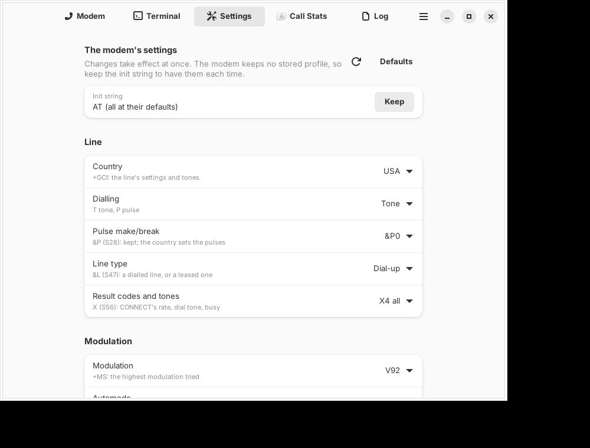
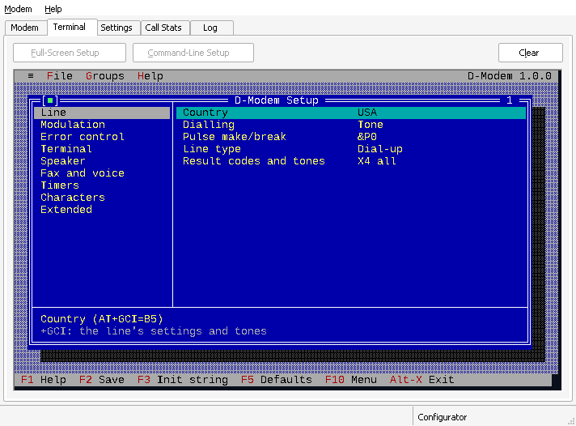
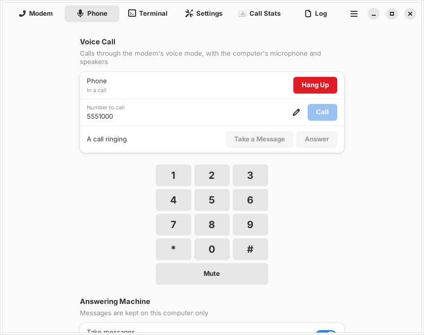
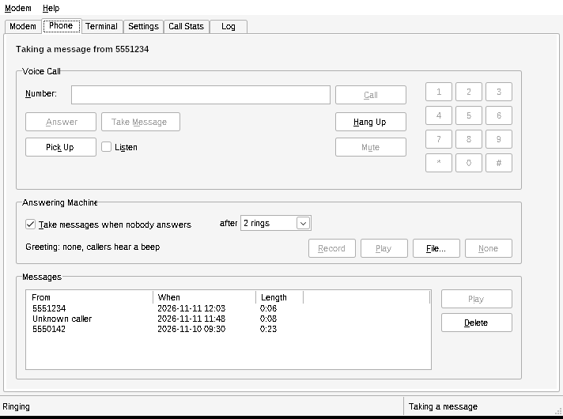

# D-Modem desktop apps

Native apps for D-Modem on Windows, macOS and Linux.

Each app starts dmodemd (or reaches one that already runs), and shows the
modem as a desktop program should: dial and answer from a window, change
its settings without AT commands, and see how the last call went. All three
are thin native shells over one small C library, libdmodemctl, so they
behave the same.

- **Modem**: the call's state, dial, answer and hang up, and the line it uses
- **Phone**: voice calls through the sound card (dial, answer, keypad), and an
  answering machine that takes messages on this computer when turned on (off by default)
- **Terminal**: the AT console, and the modem's own setup screens (AT!CF, AT!CT)
- **Remote**: log in to a server by SSH (built in, on libssh: OpenSSH's keys, agent, config and known hosts), Telnet or rlogin, in a terminal of its own
- **Settings**: every modem setting as a native control, from AT!M
- **Call Stats**: the last call's rate, modulation, error control and line figures (AT#UD, ATI11)
- **Line settings**: a SIP account, a USB modem, or a modem that already runs
- **Windows 95 and later**: plain Win32, built with Open Watcom; on Windows 9x it reaches a modem over TCP or a COM port

| | Windows | macOS | Linux |
| --- | --- | --- | --- |
| Toolkit | Win32, C++ | SwiftUI | GTK 4, libadwaita, VTE |
| Runs on | Windows 95 and later | macOS 13 and later | GTK 4.10, libadwaita 1.5 and VTE 0.76 or later (Ubuntu 24.04, Fedora 40) |

 

 

## Quick start

Linux:

    sudo apt install cmake libgtk-4-dev libadwaita-1-dev libvte-2.91-gtk4-dev \
        libpulse-dev libsndfile1-dev
    cmake -S . -B build && cmake --build build && ./build/linux/dmodem-gui

Windows: `cmake -S . -B build -A Win32 && cmake --build build --config Release`,
or for Windows 95 and later, `windows/build-watcom.sh` with Open Watcom 2.0.

macOS: `cmake -S . -B build -DCMAKE_OSX_ARCHITECTURES="arm64;x86_64" -DCMAKE_OSX_DEPLOYMENT_TARGET=13.0 && cmake --build build`
(libssh, for SSH), then `brew install xcodegen && cd macos && xcodegen && open DModem.xcodeproj`.

The first CMake build downloads libssh and mbedTLS for SSH (Windows and
macOS always; Linux when the system's libssh is older than 0.11).

The Settings page needs a dmodemd with AT!M (D-Modem's main branch since
D-Modem/D-Modem#103); the other pages work with any D-Modem 1.0.

## Documentation

- [Design](docs/design.md): how the apps are built, what they share, and the Windows 9x notes
- [libdmodemctl](core/include/dmodemctl.h): the library's API

## The D-Modem suite

| Repository | What it is |
| --- | --- |
| [D-Modem](https://github.com/D-Modem/D-Modem) | The open V.92 softmodem: dmodemd, libdmodem and the Asterisk, FreeSWITCH and ARI modules |
| [app](https://github.com/D-Modem/app) | The D-Modem app for Android and iOS: a dial-up modem on a SIP call |
| [gui](https://github.com/D-Modem/gui) | D-Modem on the desktop: native apps for Windows, macOS and Linux |
| [hardware](https://github.com/D-Modem/hardware) | pico-serial: RP2040 serial adapters and phone-line USB sticks |
| [menu](https://github.com/D-Modem/menu) | modemmenu: the login and menu dial-up callers reach |
| [bbs](https://github.com/D-Modem/bbs) | A bulletin board for telnet, SSH, TN3270 and modem callers |
| [go3270](https://github.com/D-Modem/go3270) | A Go library for 3270 terminal servers, used by bbs |
| [brand](https://github.com/D-Modem/brand) | Logos, colours, type and the naming guide |

## Licence

AGPL-3.0-only ([LICENSE](LICENSE)), or a commercial licence from the D-Modem Authors ([COMMERCIAL-LICENSE.md](COMMERCIAL-LICENSE.md)). Contributions come with a contributor agreement ([CONTRIBUTING.md](CONTRIBUTING.md)).
