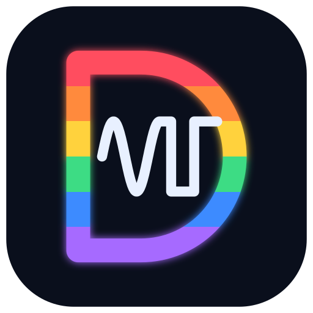
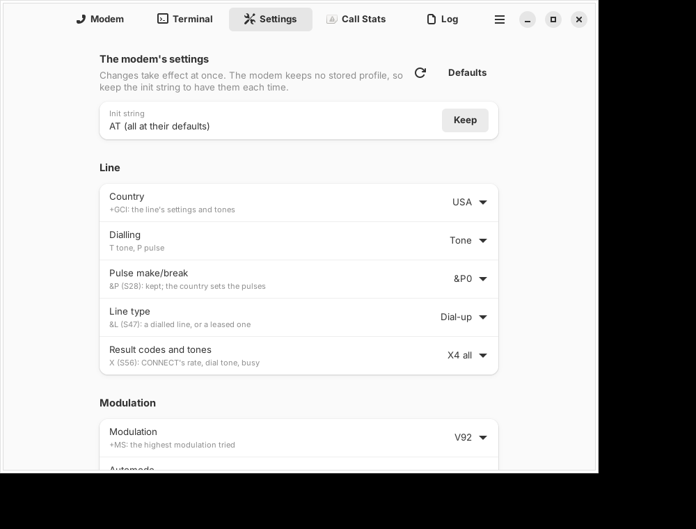
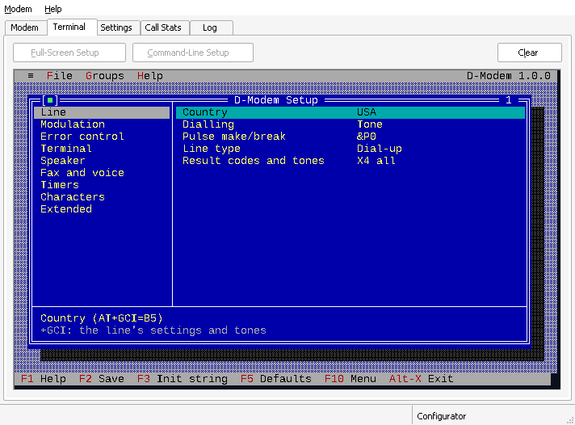
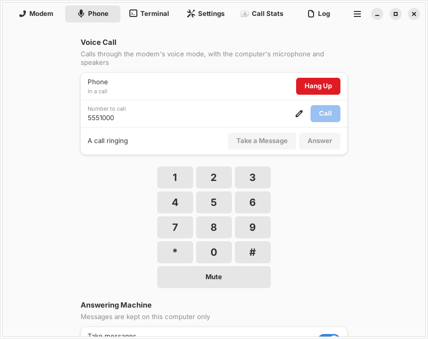

# D-Modem desktop apps

**D-Modem on the desktop: a V.92 modem in a window, from Windows 95 to
Windows 11, on macOS and on Linux.**

The apps have the modem built in. You do not need modem hardware or a
separate `dmodemd`. Dial a BBS, a fax machine or an ISP from a SIP call,
a USB modem or a hardware modem.

[Download the nightly build](download.md){ .md-button .md-button--primary }
[Source on GitHub](https://github.com/D-Modem/gui){ .md-button }

 

## What the apps do

-   **Modem**

    ---

    The state of the call. Dial, answer and hang up. Select the line that
    the modem uses: a SIP account, a USB modem, or a modem that already
    runs.

-   **Phone**

    ---

    Voice calls through the sound card, with a keypad. An answering machine
    can take messages on this computer. It is disabled by default.

-   **Terminal**

    ---

    The AT console and the setup screens of the modem (`AT!CF`, `AT!CT`).
    The emulator has xterm, DEC VT52 to VT525, ANSI-BBS, PETSCII, ATASCII,
    Viewdata, Minitel and Tektronix 4014.

-   **Remote**

    ---

    Log in to a server by SSH, Telnet or rlogin. SSH is built in. It uses
    the keys and the agent of OpenSSH and PuTTY.

-   **Settings**

    ---

    Each setting of the modem as a native control, from `AT!M`. You do not
    have to type AT commands.

-   **Call Stats**

    ---

    The rate, the modulation, the error control and the line figures of
    the last call (`AT#UD`, `ATI11`).

[All the features](features.md){ .md-button }

 

## Three native apps, one library

Each app uses the native toolkit of its system. All three apps are thin
shells over one small C library, libdmodemctl. Thus they operate in the
same way.

| | Windows | macOS | Linux |
| --- | --- | --- | --- |
| Toolkit | Win32, C++ | SwiftUI | GTK 4, libadwaita |
| Runs on | Windows 95 and later | macOS 13 and later | GTK 4.10 and libadwaita 1.5 or later (Ubuntu 24.04, Fedora 40) |
| Built-in modem | Yes | Yes | Yes |

The Windows app is plain Win32, built with
[clang-retro](https://clang-retro.github.io/). The same Win32 code also
runs on Linux and macOS, over the portable Win32 layer of
[clang-retro MFC](https://github.com/clang-retro/mfc). Refer to
[Design](design.md).

## Start here

- **Use the app:** [download the nightly build](download.md) for your
  system.
- **Build the app:** refer to [Building](building.md).
- **Use the modem without dmodemd:** refer to
  [The built-in modem](embedded-modem.md).
- **Learn how the apps are built:** refer to [Design](design.md) and to
  the API of [libdmodemctl](https://github.com/D-Modem/gui/blob/main/core/include/dmodemctl.h).

## Part of the D-Modem suite

The desktop apps are one part of the [D-Modem suite](https://d-modem.github.io/).
The suite has the softmodem ([D-Modem](https://d-modem.github.io/D-Modem/)),
the [app for Android and iOS](https://d-modem.github.io/app/), the
[pico-serial boards](https://d-modem.github.io/hardware/), and the
servers that answer callers ([login](https://d-modem.github.io/login/) and
[bbs](https://d-modem.github.io/bbs/)).

## Licence

AGPL-3.0-only ([LICENSE](../LICENSE)), or a commercial licence from the
D-Modem Authors ([COMMERCIAL-LICENSE.md](../COMMERCIAL-LICENSE.md)).
Contributions come with a contributor agreement
([CONTRIBUTING.md](../CONTRIBUTING.md)).
